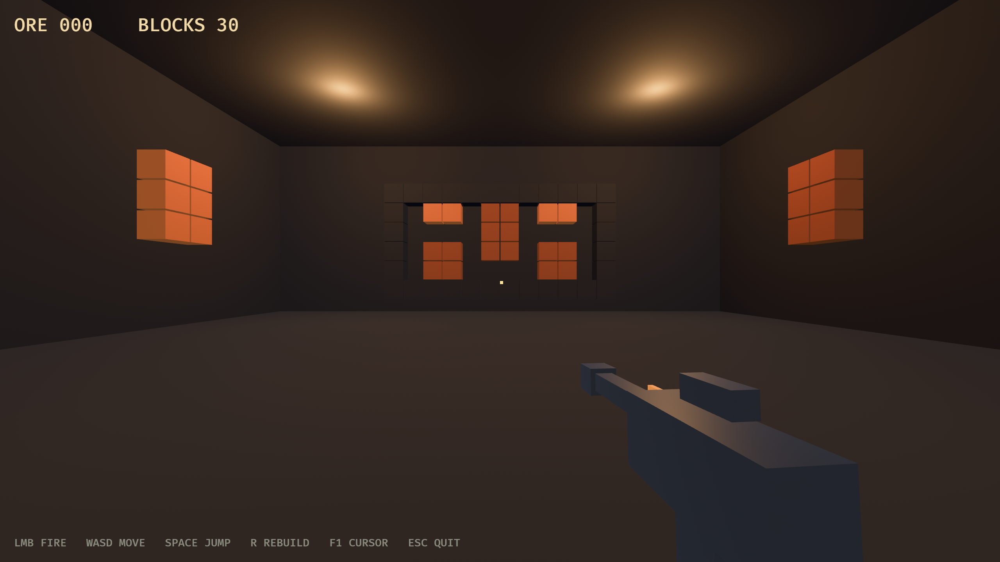

# Vein Breaker

第一人称射击采矿：在坍塌的矿脉里用凿岩枪打碎矿层，回收矿石。

- 技术栈：Rust + [Bevy 0.20](https://bevy.org/news/bevy-0-20/) + [Avian 0.8](https://joonaa.dev/blog/14/avian-0-8)
- 平台：Windows 桌面
- 状态：**Prototype 0.1**（可运行，尚无失败条件与音效）



## 现在能玩什么

- 第一人称移动、视角、跳跃；
- 按住左键射击矿层，矿砖按 HP 逐级开裂、最终破碎；
- 矿石掉落、自动磁吸、HUD 计数；
- 三种矿：岩石 / 铜 / 铁（越硬越值钱）；
- `R` 重建矿层，`F1` 释放鼠标，`Esc` 退出。

## 运行

```powershell
cargo run --offline
```

> 首次构建需要编译整棵 Bevy 依赖树（约 30 分钟）；之后增量约 25 秒。
> 依赖已缓存时请加 `--offline`，否则 cargo 可能卡在代理更新索引。

无人工截图验证：

```powershell
cargo run --offline -- --screenshot docs/images/prototype.png
```

## 文档

| 文件 | 内容 |
|---|---|
| [docs/design-brief.md](docs/design-brief.md) | 方向、当前缺口（为什么还不是游戏）、下一步 |
| [docs/gameplay-spec.md](docs/gameplay-spec.md) | 已实现的规则与数值 |
| [docs/prototype-01.md](docs/prototype-01.md) | 代码地图、关键决策、Bevy 0.20 踩坑 |
| [docs/architecture.md](docs/architecture.md) | 目标架构（含未来 RON 关卡、状态机） |
| [docs/ai-workflow.md](docs/ai-workflow.md) | AI 协作流程、技能库调研、验证阶梯 |
| [AGENTS.md](AGENTS.md) | 给 AI 的一页契约 |

## 目录

```
crates/vb_core   纯规则（矿种、HP、伤害）+ 毫秒级单测
crates/vb_game   Bevy 应用（关卡 / 玩家 / 射击 / 采矿 / HUD）
docs/            设计、规格、原型说明、截图
.agents/skills/  项目技能（DSH 自动发现）
```

## 已验证的版本组合

`bevy 0.20.0` + `avian3d 0.8.0` 依赖解析与编译通过；`bevy_hanabi` 与
`bevy_fps_controller` 当前仍锁 Bevy 0.19，暂不引入。
